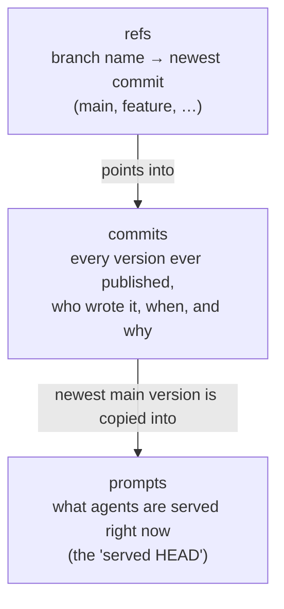
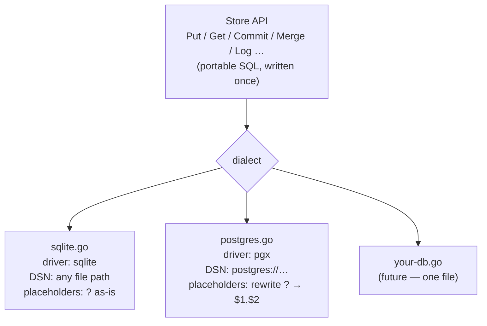

# priompt db-adapters

**The filing cabinet of Priompt.** Everything a
[Priompt](https://github.com/) server knows — every prompt, every historical
version, every branch pointer — is physically kept by this library, in a real
database, with optional encryption so a stolen database file is useless.

It ships two backends and is deliberately structured so adding a third is a
one-file job:

| Backend | When to use it |
| --- | --- |
| **SQLite** (the default) | Self-hosting, single server. Pure-Go driver — no installs, the database is just a file |
| **PostgreSQL** | Multiple server nodes sharing one database |

## What's inside the cabinet



Three tables — that's the whole story:

- **prompts** — the current live version of each prompt (what agents get).
- **commits** — the full history: every version, content-addressed, with
  parent links (like Git commits), author, message, timestamp.
- **refs** — branch pointers: which commit is the tip of `main`, `feature`, …

A commit on `main` updates all three in **one transaction**, so the live
version can never drift from the recorded history. Schema changes are ordered,
append-only migration steps, applied automatically and idempotently at `Open`.

## Using it

```go
import store "priomptdb"

st, _ := store.Open("prompts.db")                  // a file path -> SQLite
st, _ := store.Open("postgres://user:pw@host/db")  // a postgres:// DSN -> PostgreSQL
```

The API covers the whole lifecycle: `Put`/`Get`/`List`/`Dump` for the served
HEAD, `Commit`/`Branch`/`Merge`/`Log`/`Resolve`/`SetBranch`/`GetCommit` for
history, branching, and rollback.

## Encryption at rest

Set one environment variable and prompt content is encrypted with
**AES-256-GCM** before it touches the disk:

```sh
export PRIOMPT_ENCRYPTION_KEY=$(head -c32 /dev/urandom | base64)   # base64 of 32 bytes
```

Think of it as the cabinet's lock: anyone who steals the drawer (the `.db`
file, a Postgres dump) gets ciphertext. The honest fine print:

- **At rest, not end-to-end** — the server holds the key and decrypts to do
  its job (validation, semantic diff).
- **No migration to turn it on** — encrypted values carry a marker, so old
  plaintext rows stay readable while new writes are encrypted.
- The `version_hash` column stays plaintext (it's a fingerprint, not content),
  so caching and deduplication keep working.
- **Lose the key and encrypted rows are unrecoverable.** Every process that
  opens the same database must share the key.

## How the pluggable-backend part works

All SQL in this library is portable and written **once**, in `?`-placeholder
style. A backend ("dialect") only tells the library three things:



```go
type dialect struct {
    driver string                // database/sql driver name
    match  func(dsn string) bool // does this DSN belong to this backend?
    rebind func(q string) string // ?-style placeholders -> native style
}
```

### Adding a database

1. Create `<name>.go` with a `dialect` var, blank-importing its driver —
   `postgres.go` is the pattern to copy.
2. Add it to the `dialects` list in `dialect.go`, **before** `sqlite` (sqlite
   is the catch-all: any DSN nobody claims is treated as a file path).
3. Check upserts: the queries use `ON CONFLICT`, which SQLite and Postgres
   share. An engine without it (e.g. MySQL's `ON DUPLICATE KEY`) needs a
   per-dialect upsert clause — add that to `dialect` when such a backend
   actually lands.

Tests run on SQLite in a temp directory — `go test ./...`, nothing to install.

## Relation to the core repo

The Priompt server imports this module directly (as `priomptdb`) — there is
one copy of the storage engine and this repo is it. During local development
the server's `go.mod` points here with a `replace` directive; when this module
is published under its public path, that directive is swapped for a normal
`require`.
